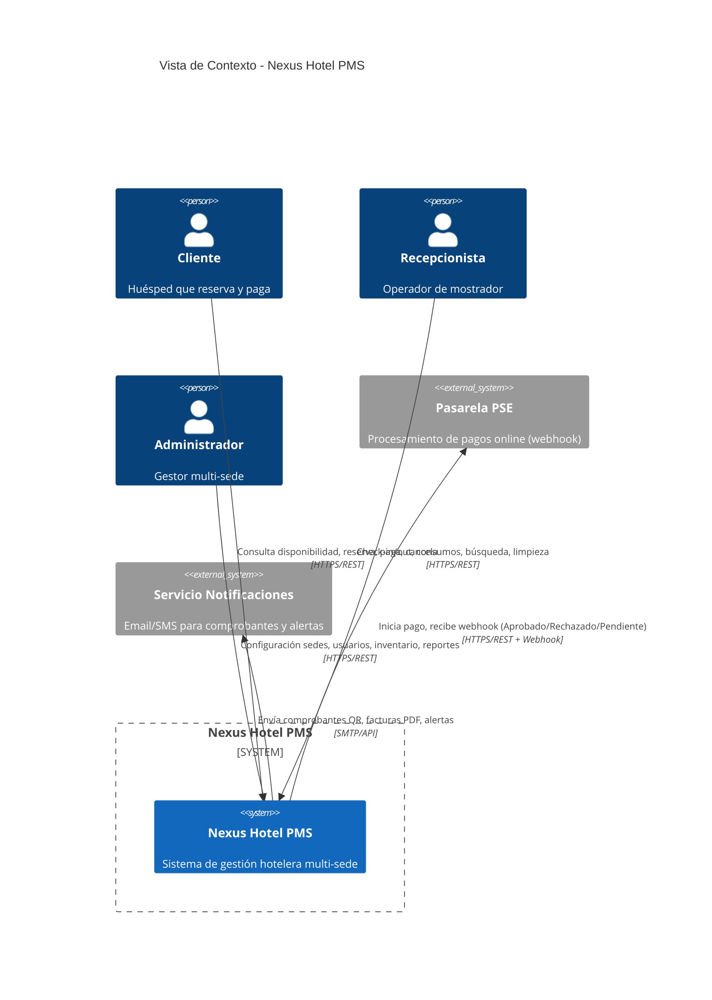

# Vista de Contexto — Nexus Hotel PMS

> **Propósito:** Mostrar el sistema como una caja negra y sus interacciones con actores externos y sistemas colindantes.

---

## Actores Externos

| Actor | Tipo | Descripción | Interacciones Principales |
|-------|------|-------------|---------------------------|
| **Cliente (Huésped)** | Humano | Usuario final que reserva, paga, cancela y recibe comprobantes | HU-01, HU-02, HU-03, HU-04, HU-05 |
| **Recepcionista** | Humano | Operador de mostrador: check-in/out, consumos, búsqueda, no-shows, limpieza | HU-06, HU-07, HU-08, HU-09, HU-10, HU-11 |
| **Administrador** | Humano | Gestor global: sedes, usuarios, inventario, catálogo, reportes | HU-06, HU-13, HU-14, HU-15, HU-16, HU-17 |
| **Pasarela PSE** | Sistema | Proveedor de pagos online (asíncrono, webhook) | HU-03 |
| **Servicio de Correo/Notificaciones** | Sistema | Envío de comprobantes, facturas, alertas | HU-05, HU-12 |

---

## Diagrama de Contexto (Mermaid)

---

## Flujo Principal de Interacciones

1. **Cliente** → Consulta disponibilidad (HU-01) → Selecciona habitación
2. **Cliente** → Registra reserva → Sistema bloquea habitación 15 min (HU-02)
3. **Cliente** → Paga via **PSE** → PSE responde async → Webhook actualiza estado (HU-03)
4. **Sistema** → Genera comprobante PDF con QR → **Email** → Cliente (HU-05)
5. **Recepcionista** → Busca reserva (HU-07) → Check-in QR (HU-08) → Marca No-Show si aplica
6. **Recepcionista** → Registra consumos (HU-09) → Check-out con late fee (HU-10)
7. **Sistema** → Auto-transición a *En Limpieza* (HU-11) → Recepcionista habilita
8. **Sistema** → Genera factura final PDF → **Email** → Cliente (HU-12)
9. **Administrador** → Configura sedes, usuarios, inventario, catálogo (HU-13 a HU-16)
10. **Administrador** → Genera reportes ocupación/ingresos (HU-17)

---

## Límites del Sistema

| Dentro del Scope | Fuera del Scope |
|------------------|-----------------|
| Gestión de reservas, pagos, check-in/out, consumos, facturación | Channel manager / OTA integration |
| Multi-sede (aislamiento lógico), RBAC | Revenue management / pricing dinámico |
| Auditoría de anulaciones, trazabilidad | Housekeeping app móvil para personal de aseo |
| Reportes operativos básicos | Business Intelligence avanzado / Data Warehouse |

---

## Supuestos Arquitectónicos

- Comunicación **síncrona** (REST) para operaciones de usuario; **asíncrona** (webhook) solo para PSE.
- Una sola instancia de la aplicación sirve a todas las sedes (multitenancy lógico por `sede_id`).
- Notificaciones vía servicio externo (SMTP/SendGrid/Twilio) — no se implementa motor propio.
- QR en comprobante codifica `reserva_id`; validez hasta check-out.
